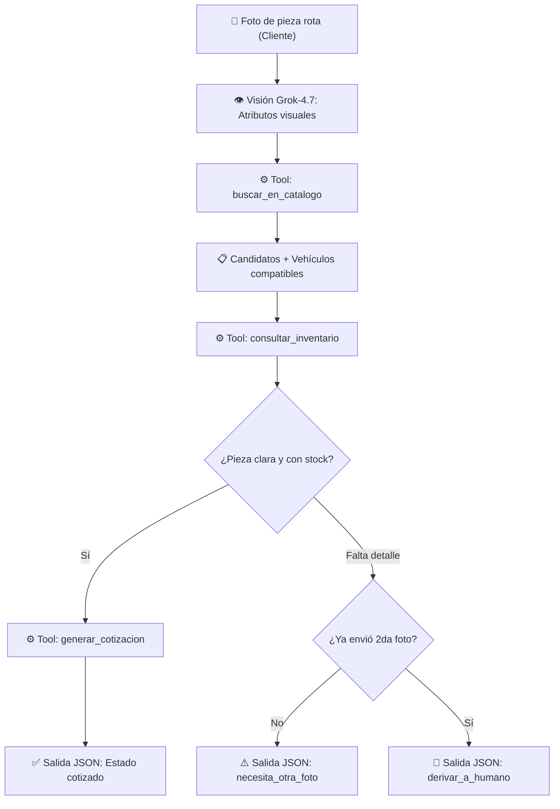

# 🚗 Agente de Refacciones Automotrices — Platica AI Agent Challenge

> **Semana 1 (12 al 17 de Octubre): Flujo End-to-End Funcional**  
> Identificación autónoma de autopartes mediante fotografías, compatibilidad determinista y cotización contra inventario real con **Grok-4.7**.

---

## 🎯 Problema que resuelve

En la industria de autopartes, la identificación de refacciones rotas depende críticamente del criterio del "vendedor experto", generando:
- Cuellos de botella en la atención al cliente.
- Cotizaciones manuales lentas y propensas a errores.
- Devoluciones costosas por incompatibilidad de vehículos.

### La solución del Agente:
El agente elimina este cuello de botella: **recibe únicamente la fotografía de la pieza rota**, utiliza **Grok-4.7** con visión para extraer sus rasgos visuales deterministas, cruza estos datos contra el catálogo y la base de datos de inventario en SQLite, y entrega una cotización formal con compatibilidad garantizada.

> [!IMPORTANT]
> **Sin alucinaciones:** Marca, modelo y año del vehículo **no son datos de entrada** y el modelo tiene prohibido inventarlos. Salen siempre de la tabla de compatibilidad del catálogo. Los precios y el stock provienen exclusivamente de la base de datos relacional.

---

## 🔄 Flujo End-to-End de la Semana 1



---

## ✅ Cumplimiento de Entregables — Semana 1

Conforme a los criterios oficiales del reto:

- [x] **Flujo End-to-End funcional:** Recibe una foto, consulta Grok, invoca herramientas y emite el resultado.
- [x] **Conexión real con Grok:** Integrado mediante `AsyncOpenAI` con el endpoint de Platica y modelo `grok-4.7`.
- [x] **Entradas y salidas reales:** Probado y validado con fotografías reales en `data/fotos_prueba/`.
- [x] **README explicativo:** Problema, arquitectura, cómo correrlo y pruebas.
- [x] **Repositorio público en GitHub:** Código versionado y documentado.
- [x] **Suite de pruebas automatizadas:** 22 pruebas unitarias y de integración pasando al 100% en `pytest`.

---

## 🛡️ Separación Estricta de Responsabilidades (Anti-Alucinaciones)

| Lo decide el Modelo (Probabilístico) | Lo decide el Código (Determinista) |
|---|---|
| Interpreta los rasgos visuales de la foto | Compatibilidad exacta vehículo-pieza (tabla del catálogo) |
| Elige qué herramienta invocar y con qué argumentos | Precios unitarios, stock disponible y ubicación (SQLite) |
| Estima su confianza visual y qué ángulo falta | Cálculo de subtotales, totales y persistencia de cotización |
| Redacta el motivo de la cotización | Validación matemática: rechaza precios o autos no encontrados en tools |
| | Límite estricto de máximo 1 foto adicional (evita bucles infinitos) |

---

## 🚀 Instalación y Puesta en Marcha

### 1. Clonar el repositorio y preparar entorno
```powershell
git clone https://github.com/MateoGomezSepulveda/Agente-de-IA.git
cd "Agente de IA"
python -m pip install -r requirements.txt
```

### 2. Variables de entorno (`.env`)
Crea un archivo `.env` en la raíz (ignorado por git):
```ini
PLATICA_BASE_URL=https://api.reto.pltk.mx/v1
PLATICA_API_KEY=tu_api_key_aqui
PLATICA_MODEL=grok-4.7
MAX_ITERACIONES=6
```

### 3. Inicializar la base de datos de inventario
```powershell
python scripts/crear_bd.py
```
*Crea `data/inventario.db` (SQLite) con 40 refacciones y casos borde (piezas sin stock, piezas fuera de catálogo).*

---

## 🎮 Modos de Uso

### Modo 1: Agente de Refacciones End-to-End (Flujo Oficial)
Ejecuta la consola interactiva que procesa fotos reales:
```powershell
python -m src.main
```
Introduce la ruta de una foto de prueba:
```text
Ruta de la foto: data/fotos_prueba/test.jpg
```

**Ejemplo de salida estructurada generada:**
```json
{
  "estado": "cotizado",
  "pieza": {
    "id": "REP-001",
    "nombre": "Balatas Delanteras Cerámicas",
    "codigo_oem": "45022-TBA-A00",
    "confianza": 0.95
  },
  "vehiculos_compatibles": [
    {"marca": "Honda", "modelo": "Civic", "anio_desde": 2016, "anio_hasta": 2021},
    {"marca": "Honda", "modelo": "CR-V", "anio_desde": 2017, "anio_hasta": 2022}
  ],
  "cotizacion": {
    "precio_unitario": 850.5,
    "stock": 12,
    "ubicacion": "Pasillo 4, Estante B",
    "total": 850.5
  },
  "alternativas": [],
  "foto_adicional_solicitada": "",
  "motivo": "Pieza identificada con alta precisión visual y confirmada en catálogo e inventario."
}
```

### Modo 2: Consola de Chat y Agente de Código (CLI)
Para interactuar directamente con el modelo Grok y usar herramientas de sistema:
```powershell
python scripts/chat.py
```

---

## 🧪 Pruebas Automatizadas (22/22 PASSED)

Para validar todo el sistema sin gastar créditos de API ni requerir conexión a internet, se implementó un cliente simulado (`src/llm_mock.py`):

```powershell
pytest -v
```

**Cobertura de pruebas:**
- `tests/test_agent.py`: Rechazo de precios inventados, validación de compatibilidad y control de 2da foto.
- `tests/test_tools.py`: Búsqueda en catálogo, consultas SQL y cálculo de totales.
- `tests/test_vision.py`: Validación de firmas binarias (magic bytes), archivos corruptos y formatos admitidos.

---

## 📂 Estructura del Proyecto

```text
Agente de IA/
├── data/
│   ├── catalogo.json           # 40 piezas con atributos y tabla de compatibilidad
│   ├── inventario.db           # Base de datos SQLite (ERP simulado)
│   └── fotos_prueba/           # Imágenes de prueba validadas (JPG)
├── src/
│   ├── agent.py                # Orquestador del bucle ReAct y validador anti-alucinaciones
│   ├── config.py               # Configuración y cliente AsyncOpenAI
│   ├── db.py                   # Consultas SQL parametrizadas a SQLite
│   ├── llm_mock.py             # Simulador de LLM para pruebas offline sin costo
│   ├── main.py                 # CLI del flujo de fotos end-to-end
│   ├── tools.py                # Herramientas: catálogo, inventario y cotización
│   ├── tracking.py             # Registro de telemetría, latencia y tokens
│   └── vision.py               # Validación y codificación Base64 de imágenes
├── tests/                      # Suite de 22 pruebas automatizadas (pytest)
├── scripts/
│   ├── crear_bd.py             # Inicializador de la base de datos SQLite
│   └── chat.py                 # Consola interactiva del agente
├── README.md                   # Documentación oficial de la entrega
└── requirements.txt            # Dependencias fijas del proyecto
```
