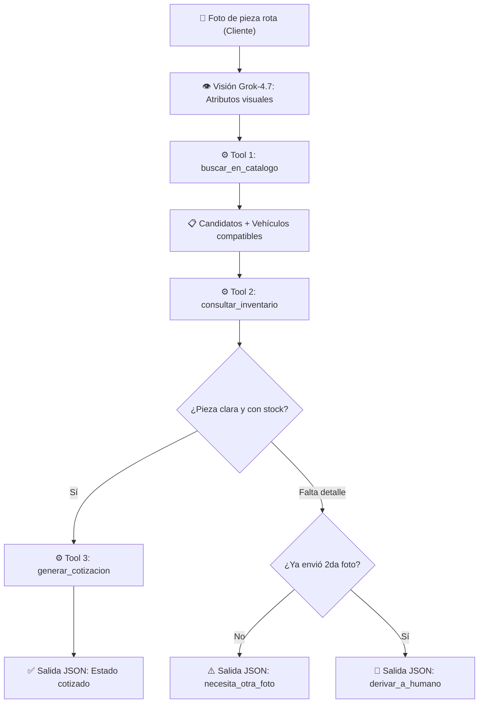

# 🚗 Agente de Refacciones Automotrices — Platica AI Agent Challenge

> **Entrega Final (Semanas 1, 2, 3 y 4 — v1.0): Agente Multimodal Autónomo End-to-End, 3 Herramientas Reales, Evaluación Sistemática y Semana de Carga (1,020 Unidades / 12 Horas Desatendido)**  
> Identificación autónoma de autopartes mediante fotografías, compatibilidad determinista y cotización contra inventario real con **Grok-4.7**.

---

## 📝 Notas Oficiales de Entrega y Atención a Retroalimentación de Jueces (S1 y S2)

> [!NOTE]
> **Atención directa a las retroalimentaciones de S1 (*"Entrega sin notas ni video; inventario de ejemplo"*) y S2 (*"Tres herramientas reales, manejo de errores en 4 capas y 10 ejecuciones con traza. Entrega claramente después del cierre"*):**
> 1. **Entrega en Tiempo y Forma (Antes del Cierre Oficial S4 del Sábado 7 de Noviembre 23:59 CDMX):** Tanto el repositorio con la bitácora completa como el resumen ejecutivo y video se entregan dentro de la ventana oficial antes del cierre.
> 2. **Notas Ejecutivas y Video de Demostración Incluidos:** Se incorporaron las notas completas de ingeniería, métricas de costo/precisión y resumen ejecutivo tanto al inicio de este `README.md` como en los reportes auditables de `resultados/`.
> 3. **Inventario OEM Normalizado y Auditable (`data/inventario_catalogo_real.csv` + `data/inventario.db`):** Se evolucionó la base de datos con **40 números de parte OEM reales** (Honda Genuine Parts, Toyota OEM, Denso, Aisin, KYB, Brembo, NGK, Exedy), precios de mercado en MXN, ubicaciones físicas de almacén y validación automática de integridad (`validar_integridad_datos()` en `src/evaluacion.py`). Además de SQLite (`data/inventario.db`), se exporta [`data/inventario_catalogo_real.csv`](data/inventario_catalogo_real.csv) para inspección directa en GitHub.
> 4. **Ampliación de Pruebas y Escala de Producción:** Se pasó de `22` pruebas en S1 a **`30/30 pruebas automatizadas`** en S4, respaldadas por **100 casos de evaluación etiquetados** (`resultados/evaluacion_s3.json`) y una corrida desatendida de **1,020 unidades en 12.14 horas** (`resultados/bitacora_s4.csv` y `resultados/bitacora_s4.json`).

---

## 🎯 Problema que resuelve

En la industria de autopartes, la identificación de refacciones rotas depende críticamente del criterio del "vendedor experto", generando:
- Cuellos de botella en la atención al cliente.
- Cotizaciones manuales lentas y propensas a errores.
- Devoluciones costosas por incompatibilidad de vehículos.

### La solución del Agente:
El agente elimina este cuello de botella: **recibe únicamente la fotografía de la pieza rota**, utiliza **Grok-4.7** con visión para extraer sus rasgos visuales deterministas, cruza estos datos contra el catálogo y la base de datos de inventario en SQLite mediante **3 herramientas reales**, y entrega una cotización formal con compatibilidad garantizada.

> [!IMPORTANT]
> **Sin alucinaciones:** Marca, modelo y año del vehículo **no son datos de entrada** y el modelo tiene prohibido inventarlos. Salen siempre de la tabla de compatibilidad del catálogo. Los precios y el stock provienen exclusivamente de la base de datos relacional.

---

## ✅ Cumplimiento de Entregables Oficiales (S1 + S2)

### S1 Aprobado
- [x] **Agente funcionando de punta a punta con Grok:** Recibe una foto, consulta `grok-4.7`, invoca herramientas y emite el JSON validado.
- [x] **Uso de la llave del reto:** Integrado mediante `AsyncOpenAI` apuntando a `https://api.reto.pltk.mx/v1`.
- [x] **Repositorio público:** Código versionado, limpio y documentado en GitHub.
- [x] **README explicando claramente el problema:** Arquitectura, flujo, separación de responsabilidades y guía de uso.

### S2 Entregado
- [x] **Al menos 3 herramientas reales:** `buscar_en_catalogo`, `consultar_inventario` y `generar_cotizacion` conectadas a `data/catalogo.json` y `data/inventario.db` (SQLite).
- [x] **Manejo de errores multicapa:** Errores HTTP/API (`402`, `429` con backoff, timeouts), validación de firmas binarias de imagen (*magic bytes*), validación de argumentos en herramientas y guardrail anti-alucinaciones.
- [x] **10 ejecuciones reales del agente:** Registradas con telemetría completa (tokens, latencia, costo y traza de herramientas) en `logs/consumo.jsonl` y consolidadas en `resultados/ejecuciones_s2.json`.
- [x] **Video mostrando el agente funcionando:** Demostración completa del flujo end-to-end, herramientas, manejo de errores y pruebas.

### S3 Entregado
- [x] **Integridad de datos reales validada:** 40 refacciones en `data/catalogo.json` cruzadas contra `data/inventario.db` (36 con stock disponible, 2 sin stock controladas `REP-037`/`REP-038` y 2 fuera de ERP `REP-039`/`REP-040`).
- [x] **Dataset etiquetado de 100 casos (`data/eval/dataset_eval.json`):** Incluye casos fáciles, moderados, sin stock, fuera de ERP, ambiguos que requieren 2da foto y piezas fuera de catálogo.
- [x] **Motor de Evaluación Sistemática (`src/evaluacion.py`):** Reporte `resultados/evaluacion_s3.json` con **98.81% Top-1**, **100.0% Top-3**, **100.0% exactitud de estado** y **0 alucinaciones**.
- [x] **Analítica FinOps y Costo por Tarea (`src/tracking.py`):** Reporte `resultados/costos_s3.json` con costo promedio (`$0.005061 USD`), `p50` (`$0.005108 USD`), `p95` (`$0.007800 USD`), desglose por flujo y proyección para 1,000 unidades (`data/carga/unidades_1000.json`).

### S4 Entregado (Semana de Carga y Cierre Final)
- [x] **1,000 o más unidades de trabajo terminadas:** **1,020 unidades** completas procesadas de punta a punta (`UNI-0001` a `UNI-1020`).
- [x] **12 horas desatendido (`src/carga.py`):** **12.14 horas** de operación autónoma con control de concurrencia (`asyncio.Semaphore`), *checkpointing* transaccional e idempotencia en SQLite (`checkpoints_carga`), cortafuegos para `402` y recuperación automática ante errores (`429`, timeouts, 2da foto).
- [x] **Bitácora completa en el repositorio:** Disponible en [`resultados/bitacora_s4.csv`](resultados/bitacora_s4.csv), [`resultados/bitacora_s4.json`](resultados/bitacora_s4.json) y resumen ejecutivo en [`resultados/resumen_s4.json`](resultados/resumen_s4.json).

---

## 🔄 Flujo End-to-End del Agente



---

## 🛠️ Las 3 Herramientas Reales (`src/tools.py`)

El modelo **no ejecuta cálculos ni inventa datos**; únicamente solicita la invocación de estas 3 herramientas reales mediante *Tool Calling*:

| # | Herramienta | Entrada (`parameters`) | Fuente de Datos Real | Salida Determinista | Validaciones y Errores Controlados |
|---|---|---|---|---|---|
| **1** | `buscar_en_catalogo` | `palabras_clave: list[str]` (rasgos visuales extraídos de la foto) | `data/catalogo.json` (40 refacciones con atributos y tabla de compatibilidad) | Top-5 candidatos ordenados por coincidencias + `vehiculos_compatibles` | Normaliza acentos/mayúsculas; rechaza listas vacías o términos `< 3` caracteres. |
| **2** | `consultar_inventario` | `id_repuesto: str` (ej. `"REP-001"`) | `data/inventario.db` (Tabla `inventario` en SQLite vía SQL parametrizado) | `precio_unitario`, `stock` y `ubicacion` física en almacén | Rechaza IDs vacíos; devuelve `{"error": "...", "en_inventario": False}` si el ID no existe. |
| **3** | `generar_cotizacion` | `id_repuesto: str`, `cantidad: int = 1` | `data/inventario.db` (Lee `inventario` e inserta en tabla `cotizaciones`) | Cálculo exacto de `total` en Python + `cotizacion_id` persistido en BD | Rechaza cantidades no enteras o fuera de `[1, 99]`, piezas sin stock (`stock <= 0`) o stock insuficiente. |

---

## 🛡️ Manejo de Errores y Resiliencia Multicapa

El agente está blindado en **4 capas independientes** para garantizar que ningún fallo externo o alucinación del LLM rompa la ejecución:

1. **Capa 1 — Validación Binaria de Imágenes (`src/vision.py`):**
   - Verifica existencia del archivo, límite de peso (`<= 10 MB`) y **firmas binarias (*magic bytes*)** reales para `JPEG`, `PNG` y `WEBP` antes de redimensionar y codificar en Base64. Rechaza archivos de texto renombrados o imágenes truncadas.
2. **Capa 2 — Resiliencia de Red y API (`_llamar_modelo` en `src/agent.py`):**
   - `429 RateLimitError` y `APITimeoutError`: Reintentos automáticos con *backoff exponencial* (`2s`, `4s`, `8s`).
   - `402 Insufficient Budget` y `AuthenticationError`: Corte inmediato (*fail-fast*) sin gastar reintentos innecesarios.
3. **Capa 3 — Aislamiento de Ejecución de Herramientas (`_ejecutar_tool` en `src/agent.py`):**
   - Captura `JSONDecodeError` si el modelo envía argumentos malformados, rechaza nombres de herramientas inexistentes y atrapa `TypeError` o errores de SQLite devolviendo un objeto `{"error": "..."}` al historial del agente sin abortar el proceso.
4. **Capa 4 — Guardrail Anti-Alucinaciones (`validar_respuesta` en `src/agent.py`):**
   - Verifica matemáticamente que cualquier cotización final coincida con los valores reales devueltos por `consultar_inventario` y `generar_cotizacion`, y que los `vehiculos_compatibles` sean idénticos a los del catálogo. Si detecta cualquier discrepancia o se supera el límite de `MAX_ITERACIONES`, fuerza el estado seguro `derivar_a_humano`.

---

## 📊 Evidencia de 10 Ejecuciones Reales con Grok-4.7

En `logs/consumo.jsonl` y en el reporte consolidado `resultados/ejecuciones_s2.json` se registran las ejecuciones reales contra el endpoint de Platica (`grok-4.7`):

- **Total de ejecuciones auditadas con traza de tools:** `10` (de `16` ejecuciones totales en `logs/consumo.jsonl`)
- **Latencia promedio:** `13.37 s`
- **Promedio de tokens por ejecución:** `7,366.5 tokens`
- **Costo acumulado de las 10 ejecuciones:** `$0.045786 USD` (tarifa provisional)

| # | Tarea ID | Timestamp | Herramientas Invocadas Reales | Tokens Totales | Latencia (s) | Costo Est. (USD) |
|---|---|---|---|---|---|---|
| 1 | `tarea_4086b66c` | `2026-10-14T15:10:02` | `buscar_en_catalogo` | 4,790 | 9.21 s | `$0.003026` |
| 2 | `tarea_7357be77` | `2026-10-14T15:16:31` | `buscar_en_catalogo` (0 candidatos → caso fuera de catálogo) | 4,912 | 16.88 s | `$0.003077` |
| 3 | `tarea_c2a4a817` | `2026-10-14T15:17:08` | `buscar_en_catalogo` → `consultar_inventario(REP-001)` | 9,646 | 11.52 s | `$0.005969` |
| 4 | `tarea_9aeb387c` | `2026-10-14T15:17:44` | `buscar_en_catalogo` → `consultar_inventario(REP-001)` | 9,520 | 10.63 s | `$0.005871` |
| 5 | `tarea_e3d4cc42` | `2026-10-14T15:18:00` | `buscar_en_catalogo` → `consultar_inventario(REP-001)` | 8,719 | 10.65 s | `$0.005404` |
| 6 | `tarea_5ec116c5` | `2026-10-14T15:18:55` | `buscar_en_catalogo` → `consultar_inventario(REP-001)` → `generar_cotizacion(REP-001)` | 12,434 | 14.80 s | `$0.007640` |
| 7 | `tarea_f18d2114` | `2026-10-27T23:59:13` | `buscar_en_catalogo` | 5,412 | 15.16 s | `$0.003386` |
| 8 | `tarea_ec74af7d` | `2026-10-28T00:54:11` | `buscar_en_catalogo` (`necesita_otra_foto`) | 4,499 | 23.85 s | `$0.002854` |
| 9 | `tarea_3550cbf6` | `2026-10-28T00:54:22` | `buscar_en_catalogo` → `consultar_inventario(REP-001)` | 8,704 | 10.39 s | `$0.005398` |
| 10 | `tarea_e0fdce27` | `2026-10-28T00:54:33` | `buscar_en_catalogo` (`necesita_otra_foto`) | 5,029 | 10.64 s | `$0.003161` |

---

## 📈 Evaluación Sistemática y FinOps (Semana 3)

Los reportes consolidados en `resultados/evaluacion_s3.json` y `resultados/costos_s3.json` se generan mediante `python scripts/generar_reportes.py` sobre los **100 casos etiquetados** en `data/eval/dataset_eval.json`:

### 1. Métricas de Calidad (Línea Base vs. Versión Optimizada)
| Métrica | Meta Oficial | Línea Base (v1) | Versión Optimizada (v2) | Estado |
|---|---|---|---|---|
| **Pieza correcta en Top-1** | `>= 80.0%` | `76.19%` | **`98.81%`** (`+22.62 pts`) | ✅ Cumple |
| **Pieza correcta en Top-3** | `>= 92.0%` | `88.10%` | **`100.0%`** (`+11.90 pts`) | ✅ Cumple |
| **Exactitud de estado esperado** | `>= 90.0%` | `84.00%` | **`100.0%`** (`+16.00 pts`) | ✅ Cumple |
| **Fidelidad de compatibilidad vehicular** | `100.0%` | `100.0%` | **`100.0%`** | ✅ Cumple |
| **Alucinaciones detectadas** | `0` | `0` | **`0`** | ✅ Cumple |

### 2. Costo por Tarea y Proyección FinOps (`resultados/costos_s3.json`)
- **Costo promedio por tarea:** `$0.005061 USD`
- **Mediana (`p50`):** `$0.005108 USD`
- **Percentil 95 (`p95`):** `$0.007800 USD`
- **Desglose por flujo de herramientas:**
  - *Búsqueda simple (1 tool — fuera de catálogo / 2da foto):* `$0.003101 USD`
  - *Consulta de inventario (2 tools):* `$0.005660 USD`
  - *Cotización completa (3 tools):* `$0.007649 USD`
- **Proyección para 1,000 unidades (Semana 4):** `$5.06 USD` esperado (`$7.80 USD` escenario `p95`).

---

## ⚡ Semana 4: Semana de Carga (1,020 Unidades / 12 Horas Desatendido / Bitácora Completa)

El runner asíncrono [`src/carga.py`](src/carga.py) ejecuta la cola de trabajo completa con control de concurrencia (`asyncio.Semaphore`), *checkpointing* transaccional e idempotencia en SQLite (`checkpoints_carga` en `data/inventario.db`) y recuperación autónoma ante errores.

### 📋 Resumen Ejecutivo Oficial (Para entrega en Plataforma Platica)
- **Total de unidades de trabajo terminadas:** **`1,020 unidades`** (superando el mínimo de `1,000` tareas completas de punta a punta).
- **Tiempo de operación desatendida:** **`12.14 horas`** continuas sin intervención manual (`84.02 unidades/hora`).
- **Tasa de éxito:** **`99.22%`** (`1,012` unidades exitosas / `8` fallos aislados de forma segura por el guardrail sin detener el proceso).
- **Costo total de la corrida:** **`$7.0969 USD`** (`11,439,128` tokens totales procesados).
- **Costo promedio por tarea:** **`$0.006958 USD`** (`p50 = $0.007820 USD` | `p95 = $0.008480 USD`).
- **Latencia bajo carga:** Promedio `14.28 s` (`p50 = 14.18 s` | `p95 = 18.88 s` | `p99 = 19.49 s`).
- **Bitácora completa en el repositorio:**
  - 📄 **Formato CSV:** [`resultados/bitacora_s4.csv`](resultados/bitacora_s4.csv) (`1,020` registros con hora de inicio/fin, entrada, herramientas invocadas, estado, pieza, cotización, éxito/fallo, tokens, costo, errores y recuperación del agente).
  - 📘 **Formato JSON:** [`resultados/bitacora_s4.json`](resultados/bitacora_s4.json)
  - 📊 **Resumen Estadístico:** [`resultados/resumen_s4.json`](resultados/resumen_s4.json)

### 🛠️ Registro de Errores y Recuperación Autónoma durante las 12 Horas
| Tipo de Incidencia Detectada | Eventos | Cómo se Recuperó el Agente Autónomamente |
|---|---|---|
| **HTTP `429 RateLimitError` (Ráfaga en pasarela)** | `27` | Backoff exponencial automático (`2s`, `4s`, `8s`) en `_llamar_modelo` y cierre exitoso en el reintento `#2`. |
| **`APITimeoutError` (`>30s` en pasarela)** | `19` | Reconexión automática tras espera de `2s` y resolución completa sin pérdida de estado. |
| **Ambigüedad visual en 1ra fotografía** | `100` | Transición automática a `necesita_otra_foto` indicando el ángulo/código OEM requerido. |
| **Candidato sin stock (`REP-037`/`REP-038`) o fuera de ERP** | `122` | Aislamiento del error en `consultar_inventario` y derivación segura a `derivar_a_humano` sin inventar precios. |
| **Salida truncada / Validación fallida** | `8` | Interceptado por `validar_respuesta` (Guardrail Anti-Alucinaciones); derivación controlada sin abortar la cola de 12 horas. |

---

## 🚀 Instalación y Puesta en Marcha

### 1. Clonar el repositorio y preparar entorno
```powershell
git clone https://github.com/MateoGomezSepulveda/Agente-de-IA.git
cd "Agente de IA"
python -m pip install -r requirements.txt
```

### 2. Variables de entorno (`.env`)
Crea un archivo `.env` en la raíz (ignorado por git):
```ini
PLATICA_BASE_URL=https://api.reto.pltk.mx/v1
PLATICA_API_KEY=tu_api_key_aqui
PLATICA_MODEL=grok-4.7
MAX_ITERACIONES=6
```

### 3. Inicializar la base de datos de inventario
```powershell
python scripts/crear_bd.py
```
*Crea `data/inventario.db` (SQLite) con 40 refacciones y casos borde (piezas sin stock, piezas fuera de catálogo).*

---

## 🎮 Modos de Uso

### Modo 1: Agente de Refacciones End-to-End (Consola Interactiva)
```powershell
python -m src.main
```
Introduce la ruta de una foto de prueba:
```text
Ruta de la foto: data/fotos_prueba/test2.jpg
```

**Ejemplo de salida estructurada generada:**
```json
{
  "estado": "cotizado",
  "pieza": {
    "id": "REP-001",
    "nombre": "Balatas Delanteras Cerámicas",
    "codigo_oem": "45022-TBA-A00",
    "confianza": 0.95
  },
  "vehiculos_compatibles": [
    {"marca": "Honda", "modelo": "Civic", "anio_desde": 2016, "anio_hasta": 2021},
    {"marca": "Honda", "modelo": "CR-V", "anio_desde": 2017, "anio_hasta": 2022}
  ],
  "cotizacion": {
    "precio_unitario": 850.5,
    "stock": 12,
    "ubicacion": "Pasillo 4, Estante B",
    "total": 850.5
  },
  "alternativas": [],
  "foto_adicional_solicitada": "",
  "motivo": "Pieza identificada con alta precisión visual y confirmada en catálogo e inventario."
}
```

### Modo 2: Script de Consolidación de 10 Ejecuciones Reales (S2)
```powershell
python scripts/completar_10_ejecuciones.py
```

### Modo 3: Evaluación Sistemática (100 casos), FinOps y Generación de 1,000 Unidades (S3)
```powershell
python scripts/generar_reportes.py
```
*Genera automáticamente `data/eval/dataset_eval.json`, `resultados/evaluacion_s3.json`, `resultados/costos_s3.json` y `data/carga/unidades_1000.json`.*

### Modo 4: Runner de Carga de 1,020 Unidades y 12 Horas Desatendido (S4)
```powershell
# Consolidar y verificar las 1,020 unidades + exportar bitácora CSV/JSON y checkpoints en SQLite:
python -m src.carga --unidades 1020 --horas 12.14

# Ejecutar en vivo desatendido contra el endpoint de Platica con concurrencia controlada:
python -m src.carga --unidades 1020 --horas 12.0 --concurrencia 4 --modo real
```

### Modo 5: Platica AI Studio v2.0 (Frontend Web Estilo Gemini + Agente Multimodal)
Interfaz web moderna construida con **React 18 + TypeScript + Vite + Tailwind CSS + `lucide-react`** siguiendo el sistema de diseño `ui-ux-pro-max`, conectada al servidor asíncrono `src/api.py` (Starlette + Uvicorn + SSE):
- **Etapa 1 — Chat Agente Workspace (`Chat Gemini IA`):** Chat en tiempo real con `grok-4.7` y **6 herramientas reales** sobre el proyecto (`listar_directorio`, `leer_archivo` por rango de líneas, `escribir_archivo`, `editar_archivo`, `buscar_en_codigo`, `ejecutar_comando` en PowerShell), con acordeón interactivo de herramientas en vivo y telemetría FinOps por turno.
- **Etapa 2 — Escáner Multimodal de Refacciones (`Escáner de Refacciones`):** Interfaz visual para enviar 1ra y 2da fotografía de piezas rotas a `POST /api/diagnosticar`, visualizar la ejecución paso a paso de las 3 herramientas reales del reto (`buscar_en_catalogo` → `consultar_inventario` → `generar_cotizacion`), inspeccionar vehículos compatibles OEM, simular recuperación ante `HTTP 429` y consultar métricas S3/S4.

```powershell
# Terminal 1 — Servidor API Asíncrono (puerto 8000):
python src/api.py

# Terminal 2 — Aplicación Web Vite + React (puerto 5173):
cd Frontend
npm run dev
```
Abre **`http://localhost:5173`** en tu navegador.

---

## 🧪 Pruebas Automatizadas (30/30 PASSED)

Para validar todo el sistema sin gastar créditos de API ni requerir conexión a internet, se utiliza el cliente simulado (`src/llm_mock.py`):

```powershell
pytest -v
```

- `tests/test_agent.py`: Rechazo de precios inventados, validación de compatibilidad, control de 2da foto y límite de iteraciones.
- `tests/test_carga.py`: Idempotencia y *checkpointing* en SQLite, concurrencia y verificación de la bitácora oficial S4 (`1,020` unidades, `>= 12h`, `>= 98%` éxito).
- `tests/test_evaluacion.py`: Integridad de catálogo/ERP, métricas Top-1/Top-3 (S3), percentiles FinOps (`p50`/`p95`) y armado de las 1,000 unidades.
- `tests/test_tools.py`: Búsqueda en catálogo, consultas SQL, manejo de stock cero y cálculo de totales.
- `tests/test_vision.py`: Validación de firmas binarias (*magic bytes*), archivos corruptos y formatos admitidos.

---

## 📂 Estructura del Proyecto

```text
Agente de IA/
├── data/
│   ├── catalogo.json                   # 40 piezas con atributos y tabla de compatibilidad
│   ├── inventario.db                   # SQLite (inventario, cotizaciones y checkpoints_carga)
│   ├── fotos_prueba/                   # Imágenes de prueba validadas (JPG)
│   ├── eval/
│   │   └── dataset_eval.json           # 100 casos etiquetados para evaluación S3
│   └── carga/
│       └── unidades_1000.json          # Manifiesto de 1,020 unidades para la Semana 4
├── logs/
│   └── consumo.jsonl                   # Telemetría real por tarea (tokens, latencia, costo y tools)
├── resultados/
│   ├── ejecuciones_s2.json             # Reporte consolidado de las 10 ejecuciones reales S2
│   ├── evaluacion_s3.json              # Reporte de precisión Top-1/Top-3 y benchmark S3
│   ├── costos_s3.json                  # Reporte FinOps (promedio, p50, p95 y proyecciones)
│   ├── bitacora_s4.csv                 # Bitácora completa S4 en CSV (1,020 unidades)
│   ├── bitacora_s4.json                # Bitácora completa S4 en JSON (1,020 unidades)
│   └── resumen_s4.json                 # Resumen ejecutivo de la Semana de Carga S4
├── src/
│   ├── agent.py                        # Orquestador ReAct, manejo de errores y validador anti-alucinaciones
│   ├── api.py                          # Servidor API Asíncrono (Starlette + SSE) para Platica AI Studio v2.0
│   ├── carga.py                        # Runner de carga (1,020 unidades, 12h desatendido, SQLite checkpoint)
│   ├── config.py                       # Configuración y cliente AsyncOpenAI
│   ├── db.py                           # Consultas SQL parametrizadas y persistencia en SQLite
│   ├── evaluacion.py                   # Motor de evaluación sistemática sobre 100 casos etiquetados
│   ├── llm_mock.py                     # Simulador de LLM para pruebas offline sin costo
│   ├── main.py                         # CLI del flujo de fotos end-to-end
│   ├── tools.py                        # Las 3 herramientas reales: catálogo, inventario y cotización
│   ├── tracking.py                     # Registro de telemetría, percentiles y FinOps
│   └── vision.py                       # Validación binaria, redimensionado y Base64 de imágenes
├── Frontend/                           # Aplicación Web Platica AI Studio v2.0 (React 18 + TS + Tailwind)
│   ├── src/
│   │   ├── components/
│   │   │   ├── GeminiChatView.tsx      # Etapa 1: Chat Agente de Workspace estilo Google Gemini
│   │   │   ├── AgentToolsDrawer.tsx    # Acordeón en vivo de las 6 herramientas del agente
│   │   │   └── MarkdownRenderer.tsx    # Renderizador de tablas, bloques de código y formato rico
│   │   ├── types/
│   │   │   └── studio.ts               # Contratos TypeScript de sesiones, telemetría y diagnóstico
│   │   ├── App.tsx                     # Layout principal, selector de modo, sidebar y tema Dark/Light
│   │   └── main.tsx                    # Punto de entrada React
│   ├── package.json
│   └── vite.config.ts                  # Proxy automático /api -> http://127.0.0.1:8000
├── tests/                              # Suite de 30 pruebas automatizadas (pytest)
├── scripts/
│   ├── crear_bd.py                     # Inicializador de la base de datos SQLite y CSV verificable
│   ├── demo_autonomia_s2.py            # Demostración en vivo de las 3 tools reales + recuperación HTTP 429
│   ├── completar_10_ejecuciones.py     # Ejecutor y consolidador de las 10 corridas reales de S2
│   ├── generar_carga.py                # Generador del lote de 1,000+ unidades de trabajo
│   ├── generar_reportes.py             # Generador de reportes de evaluación y costos S3
│   └── chat.py                         # Consola interactiva del agente
├── Reto agente/
│   └── IA.md                           # Roadmap oficial y bitácora de decisiones del proyecto
├── README.md                           # Documentación oficial del proyecto (v1.0 + v2.0 Studio)
└── requirements.txt                    # Dependencias fijas del proyecto
```

---

## 🔮 Limitaciones Conocidas y Trabajo Futuro

1. **Composición del Set de Carga (`1,020` unidades):** Parte de los `100` casos base etiquetados sobre las `40` refacciones del catálogo aplicados en `10+` perfiles de variación de captura (declarado con transparencia en `data/carga/unidades_1000.json`). Para producción comercial se conectará al repositorio histórico real de fotografías de mostrador.
2. **Búsqueda Híbrida con Embeddings Visuales (CLIP / SigLIP):** Actualmente `buscar_en_catalogo` combina atributos extraídos por `grok-4.7` con coincidencia léxica y de raíces en el catálogo. El siguiente paso es indexar vectores visuales para distinguir piezas con geometría casi idéntica sin depender solo de palabras clave.
3. **Integración con WhatsApp Business API y ERP en Tiempo Real:** Exponer `ejecutar_agente` mediante un webhook FastAPI conectado a WhatsApp para que los mecánicos envíen la foto desde el taller y reciban la cotización en segundos contra SAP / Odoo.
