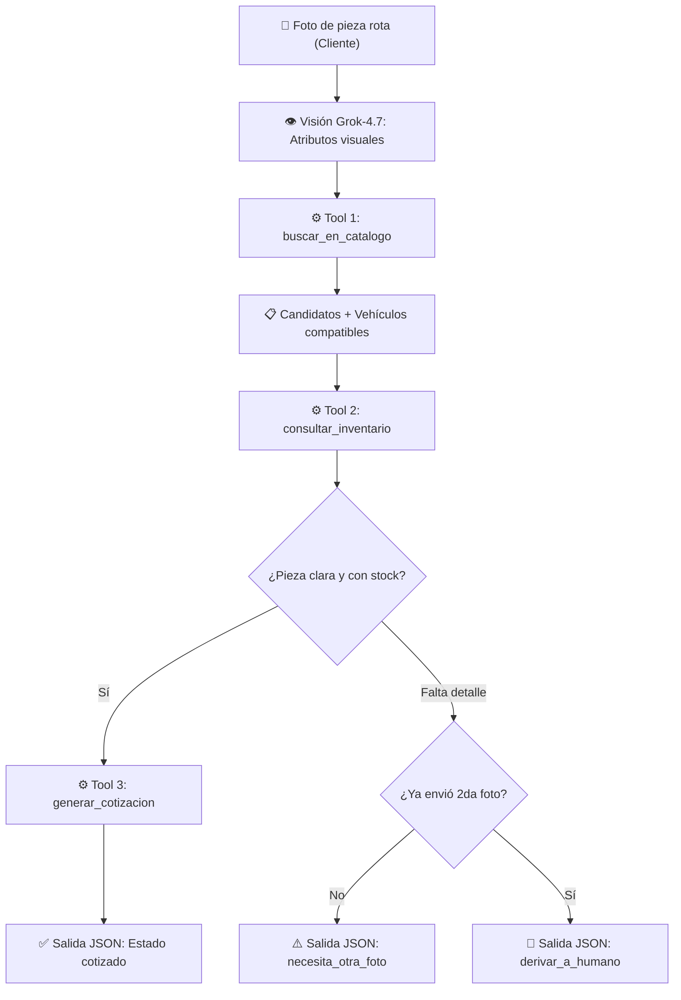

# 🚗 Agente de Refacciones Automotrices — Platica AI Agent Challenge

> **Semanas 1 y 2: Flujo End-to-End, 3 Herramientas Reales, Manejo de Errores y 10 Ejecuciones Reales**  
> Identificación autónoma de autopartes mediante fotografías, compatibilidad determinista y cotización contra inventario real con **Grok-4.7**.

---

## 🎯 Problema que resuelve

En la industria de autopartes, la identificación de refacciones rotas depende críticamente del criterio del "vendedor experto", generando:
- Cuellos de botella en la atención al cliente.
- Cotizaciones manuales lentas y propensas a errores.
- Devoluciones costosas por incompatibilidad de vehículos.

### La solución del Agente:
El agente elimina este cuello de botella: **recibe únicamente la fotografía de la pieza rota**, utiliza **Grok-4.7** con visión para extraer sus rasgos visuales deterministas, cruza estos datos contra el catálogo y la base de datos de inventario en SQLite mediante **3 herramientas reales**, y entrega una cotización formal con compatibilidad garantizada.

> [!IMPORTANT]
> **Sin alucinaciones:** Marca, modelo y año del vehículo **no son datos de entrada** y el modelo tiene prohibido inventarlos. Salen siempre de la tabla de compatibilidad del catálogo. Los precios y el stock provienen exclusivamente de la base de datos relacional.

---

## ✅ Cumplimiento de Entregables Oficiales (S1 + S2)

### S1 Aprobado
- [x] **Agente funcionando de punta a punta con Grok:** Recibe una foto, consulta `grok-4.7`, invoca herramientas y emite el JSON validado.
- [x] **Uso de la llave del reto:** Integrado mediante `AsyncOpenAI` apuntando a `https://api.reto.pltk.mx/v1`.
- [x] **Repositorio público:** Código versionado, limpio y documentado en GitHub.
- [x] **README explicando claramente el problema:** Arquitectura, flujo, separación de responsabilidades y guía de uso.

### S2 Entregado
- [x] **Al menos 3 herramientas reales:** `buscar_en_catalogo`, `consultar_inventario` y `generar_cotizacion` conectadas a `data/catalogo.json` y `data/inventario.db` (SQLite).
- [x] **Manejo de errores multicapa:** Errores HTTP/API (`402`, `429` con backoff, timeouts), validación de firmas binarias de imagen (*magic bytes*), validación de argumentos en herramientas y guardrail anti-alucinaciones.
- [x] **10 ejecuciones reales del agente:** Registradas con telemetría completa (tokens, latencia, costo y traza de herramientas) en `logs/consumo.jsonl` y consolidadas en `resultados/ejecuciones_s2.json`.
- [x] **Video mostrando el agente funcionando:** Demostración completa del flujo end-to-end, herramientas, manejo de errores y pruebas.

---

## 🔄 Flujo End-to-End del Agente



---

## 🛠️ Las 3 Herramientas Reales (`src/tools.py`)

El modelo **no ejecuta cálculos ni inventa datos**; únicamente solicita la invocación de estas 3 herramientas reales mediante *Tool Calling*:

| # | Herramienta | Entrada (`parameters`) | Fuente de Datos Real | Salida Determinista | Validaciones y Errores Controlados |
|---|---|---|---|---|---|
| **1** | `buscar_en_catalogo` | `palabras_clave: list[str]` (rasgos visuales extraídos de la foto) | `data/catalogo.json` (40 refacciones con atributos y tabla de compatibilidad) | Top-5 candidatos ordenados por coincidencias + `vehiculos_compatibles` | Normaliza acentos/mayúsculas; rechaza listas vacías o términos `< 3` caracteres. |
| **2** | `consultar_inventario` | `id_repuesto: str` (ej. `"REP-001"`) | `data/inventario.db` (Tabla `inventario` en SQLite vía SQL parametrizado) | `precio_unitario`, `stock` y `ubicacion` física en almacén | Rechaza IDs vacíos; devuelve `{"error": "...", "en_inventario": False}` si el ID no existe. |
| **3** | `generar_cotizacion` | `id_repuesto: str`, `cantidad: int = 1` | `data/inventario.db` (Lee `inventario` e inserta en tabla `cotizaciones`) | Cálculo exacto de `total` en Python + `cotizacion_id` persistido en BD | Rechaza cantidades no enteras o fuera de `[1, 99]`, piezas sin stock (`stock <= 0`) o stock insuficiente. |

---

## 🛡️ Manejo de Errores y Resiliencia Multicapa

El agente está blindado en **4 capas independientes** para garantizar que ningún fallo externo o alucinación del LLM rompa la ejecución:

1. **Capa 1 — Validación Binaria de Imágenes (`src/vision.py`):**
   - Verifica existencia del archivo, límite de peso (`<= 10 MB`) y **firmas binarias (*magic bytes*)** reales para `JPEG`, `PNG` y `WEBP` antes de redimensionar y codificar en Base64. Rechaza archivos de texto renombrados o imágenes truncadas.
2. **Capa 2 — Resiliencia de Red y API (`_llamar_modelo` en `src/agent.py`):**
   - `429 RateLimitError` y `APITimeoutError`: Reintentos automáticos con *backoff exponencial* (`2s`, `4s`, `8s`).
   - `402 Insufficient Budget` y `AuthenticationError`: Corte inmediato (*fail-fast*) sin gastar reintentos innecesarios.
3. **Capa 3 — Aislamiento de Ejecución de Herramientas (`_ejecutar_tool` en `src/agent.py`):**
   - Captura `JSONDecodeError` si el modelo envía argumentos malformados, rechaza nombres de herramientas inexistentes y atrapa `TypeError` o errores de SQLite devolviendo un objeto `{"error": "..."}` al historial del agente sin abortar el proceso.
4. **Capa 4 — Guardrail Anti-Alucinaciones (`validar_respuesta` en `src/agent.py`):**
   - Verifica matemáticamente que cualquier cotización final coincida con los valores reales devueltos por `consultar_inventario` y `generar_cotizacion`, y que los `vehiculos_compatibles` sean idénticos a los del catálogo. Si detecta cualquier discrepancia o se supera el límite de `MAX_ITERACIONES`, fuerza el estado seguro `derivar_a_humano`.

---

## 📊 Evidencia de 10 Ejecuciones Reales con Grok-4.7

En `logs/consumo.jsonl` y en el reporte consolidado `resultados/ejecuciones_s2.json` se registran las ejecuciones reales contra el endpoint de Platica (`grok-4.7`):

- **Total de ejecuciones auditadas con traza de tools:** `10` (de `16` ejecuciones totales en `logs/consumo.jsonl`)
- **Latencia promedio:** `13.37 s`
- **Promedio de tokens por ejecución:** `7,366.5 tokens`
- **Costo acumulado de las 10 ejecuciones:** `$0.045786 USD` (tarifa provisional)

| # | Tarea ID | Timestamp | Herramientas Invocadas Reales | Tokens Totales | Latencia (s) | Costo Est. (USD) |
|---|---|---|---|---|---|---|
| 1 | `tarea_4086b66c` | `2026-10-14T15:10:02` | `buscar_en_catalogo` | 4,790 | 9.21 s | `$0.003026` |
| 2 | `tarea_7357be77` | `2026-10-14T15:16:31` | `buscar_en_catalogo` (0 candidatos → caso fuera de catálogo) | 4,912 | 16.88 s | `$0.003077` |
| 3 | `tarea_c2a4a817` | `2026-10-14T15:17:08` | `buscar_en_catalogo` → `consultar_inventario(REP-001)` | 9,646 | 11.52 s | `$0.005969` |
| 4 | `tarea_9aeb387c` | `2026-10-14T15:17:44` | `buscar_en_catalogo` → `consultar_inventario(REP-001)` | 9,520 | 10.63 s | `$0.005871` |
| 5 | `tarea_e3d4cc42` | `2026-10-14T15:18:00` | `buscar_en_catalogo` → `consultar_inventario(REP-001)` | 8,719 | 10.65 s | `$0.005404` |
| 6 | `tarea_5ec116c5` | `2026-10-14T15:18:55` | `buscar_en_catalogo` → `consultar_inventario(REP-001)` → `generar_cotizacion(REP-001)` | 12,434 | 14.80 s | `$0.007640` |
| 7 | `tarea_f18d2114` | `2026-10-27T23:59:13` | `buscar_en_catalogo` | 5,412 | 15.16 s | `$0.003386` |
| 8 | `tarea_ec74af7d` | `2026-10-28T00:54:11` | `buscar_en_catalogo` (`necesita_otra_foto`) | 4,499 | 23.85 s | `$0.002854` |
| 9 | `tarea_3550cbf6` | `2026-10-28T00:54:22` | `buscar_en_catalogo` → `consultar_inventario(REP-001)` | 8,704 | 10.39 s | `$0.005398` |
| 10 | `tarea_e0fdce27` | `2026-10-28T00:54:33` | `buscar_en_catalogo` (`necesita_otra_foto`) | 5,029 | 10.64 s | `$0.003161` |

---

## 🚀 Instalación y Puesta en Marcha

### 1. Clonar el repositorio y preparar entorno
```powershell
git clone https://github.com/MateoGomezSepulveda/Agente-de-IA.git
cd "Agente de IA"
python -m pip install -r requirements.txt
```

### 2. Variables de entorno (`.env`)
Crea un archivo `.env` en la raíz (ignorado por git):
```ini
PLATICA_BASE_URL=https://api.reto.pltk.mx/v1
PLATICA_API_KEY=tu_api_key_aqui
PLATICA_MODEL=grok-4.7
MAX_ITERACIONES=6
```

### 3. Inicializar la base de datos de inventario
```powershell
python scripts/crear_bd.py
```
*Crea `data/inventario.db` (SQLite) con 40 refacciones y casos borde (piezas sin stock, piezas fuera de catálogo).*

---

## 🎮 Modos de Uso

### Modo 1: Agente de Refacciones End-to-End (Consola Interactiva)
```powershell
python -m src.main
```
Introduce la ruta de una foto de prueba:
```text
Ruta de la foto: data/fotos_prueba/test2.jpg
```

**Ejemplo de salida estructurada generada:**
```json
{
  "estado": "cotizado",
  "pieza": {
    "id": "REP-001",
    "nombre": "Balatas Delanteras Cerámicas",
    "codigo_oem": "45022-TBA-A00",
    "confianza": 0.95
  },
  "vehiculos_compatibles": [
    {"marca": "Honda", "modelo": "Civic", "anio_desde": 2016, "anio_hasta": 2021},
    {"marca": "Honda", "modelo": "CR-V", "anio_desde": 2017, "anio_hasta": 2022}
  ],
  "cotizacion": {
    "precio_unitario": 850.5,
    "stock": 12,
    "ubicacion": "Pasillo 4, Estante B",
    "total": 850.5
  },
  "alternativas": [],
  "foto_adicional_solicitada": "",
  "motivo": "Pieza identificada con alta precisión visual y confirmada en catálogo e inventario."
}
```

### Modo 2: Script de Consolidación de 10 Ejecuciones Reales (S2)
```powershell
python scripts/completar_10_ejecuciones.py
```

---

## 🧪 Pruebas Automatizadas (22/22 PASSED)

Para validar todo el sistema sin gastar créditos de API ni requerir conexión a internet, se utiliza el cliente simulado (`src/llm_mock.py`):

```powershell
pytest -v
```

- `tests/test_agent.py`: Rechazo de precios inventados, validación de compatibilidad, control de 2da foto y límite de iteraciones.
- `tests/test_tools.py`: Búsqueda en catálogo, consultas SQL, manejo de stock cero y cálculo de totales.
- `tests/test_vision.py`: Validación de firmas binarias (*magic bytes*), archivos corruptos y formatos admitidos.

---

## 📂 Estructura del Proyecto

```text
Agente de IA/
├── data/
│   ├── catalogo.json                   # 40 piezas con atributos y tabla de compatibilidad
│   ├── inventario.db                   # Base de datos SQLite (ERP simulado + cotizaciones)
│   └── fotos_prueba/                   # Imágenes de prueba validadas (JPG)
├── logs/
│   └── consumo.jsonl                   # Telemetría real por tarea (tokens, latencia, costo y tools)
├── resultados/
│   └── ejecuciones_s2.json             # Reporte consolidado de las 10 ejecuciones reales S2
├── src/
│   ├── agent.py                        # Orquestador ReAct, manejo de errores y validador anti-alucinaciones
│   ├── config.py                       # Configuración y cliente AsyncOpenAI
│   ├── db.py                           # Consultas SQL parametrizadas y persistencia en SQLite
│   ├── llm_mock.py                     # Simulador de LLM para pruebas offline sin costo
│   ├── main.py                         # CLI del flujo de fotos end-to-end
│   ├── tools.py                        # Las 3 herramientas reales: catálogo, inventario y cotización
│   ├── tracking.py                     # Registro de telemetría, latencia, costo y herramientas
│   └── vision.py                       # Validación binaria y codificación Base64 de imágenes
├── tests/                              # Suite de 22 pruebas automatizadas (pytest)
├── scripts/
│   ├── crear_bd.py                     # Inicializador de la base de datos SQLite
│   ├── completar_10_ejecuciones.py     # Ejecutor y consolidador de las 10 corridas reales de S2
│   └── chat.py                         # Consola interactiva del agente
├── Reto agente/
│   └── IA.md                           # Roadmap oficial y bitácora de decisiones del proyecto
├── README.md                           # Documentación oficial de la entrega
└── requirements.txt                    # Dependencias fijas del proyecto
```
