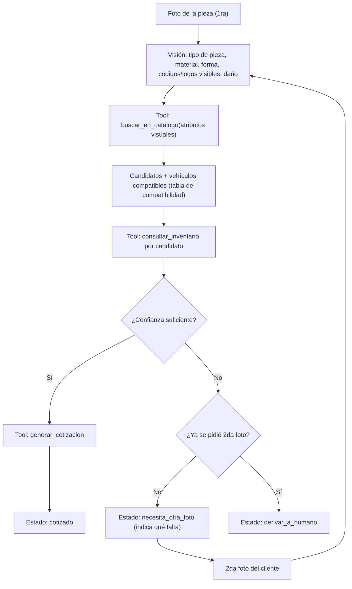

# Reto Agente IA - Platica

## 1. Objetivo
Agente autónomo para almacenes de autopartes. **Entrada: una fotografía de la pieza rota** (opcionalmente una segunda foto si la primera no alcanza). El agente: identifica la pieza, determina los **vehículos compatibles** y **cotiza contra el inventario disponible**. Elimina el cuello de botella del "vendedor experto".

> [!IMPORTANT]
> **No hay texto del cliente.** Marca, modelo y año del vehículo NO son datos de entrada: son un **resultado** que el agente debe obtener. La compatibilidad pieza-vehículo sale de la **tabla de compatibilidad del catálogo**, nunca de la memoria del modelo.

**Meta de calidad:** entregar algo de nivel profesional: funcional end-to-end, medido con datos, con costo por tarea conocido y probado a escala (1,000 unidades en 12 horas).

## 2. Entregas del reto y calendario
Inicio: **miércoles 7 de octubre de 2026**. Calendario actualizado con los lineamientos oficiales de Platica para la Semana 2 (fecha límite oficial S2: **sábado 24 de octubre, 23:59 CDMX**; actualmente en **Sprint de Cierre Inmediato S2** al 28 de octubre).

| Semana | Fecha límite oficial | Entregables oficiales exigidos por Platica | Estado actual |
|---|---|---|---|
| **S1** | Sáb 17 oct | • Agente funcionando de punta a punta con Grok<br>• Uso de la llave del reto<br>• Repositorio público<br>• README explicando claramente el problema | ✅ **APROBADO / COMPLETADO** |
| **S2** | Sáb 24 oct (23:59 CDMX) | • Al menos 3 herramientas reales<br>• Manejo de errores<br>• 10 ejecuciones reales del agente<br>• Video de 2 minutos mostrando el agente funcionando | 🚀 **EN CIERRE INMEDIATO (28 oct)** |
| **S3** | Sáb 31 oct (estimado) | Datos reales, evaluación propia y costo por tarea | Pendiente |
| **S4 / Final** | Noviembre | Semana de carga (1,000 unidades en 12 horas) y paquete final | Pendiente |

**Estrategia actual (Plan de Choque S2):** Aprovechar que las 3 herramientas reales y el manejo de errores ya fueron adelantados en el código durante la Semana 1 para cerrar hoy mismo las **10 ejecuciones reales**, actualizar el **README de S2** y grabar el **video de 2 minutos**.

## 3. Stack técnico
| Componente | Decisión |
|---|---|
| Lenguaje | Python 3.13 |
| SDK | `openai` (`AsyncOpenAI`) |
| Endpoint | `https://api.reto.pltk.mx/v1` (proxy obligatorio de Platica) |
| Modelo | Se define en `.env` (`PLATICA_MODEL`). El endpoint lista `grok-4.3` a `grok-4.7`, `grok-4.20-*` y otros. El ejemplo oficial de Platica usa `grok-4.6`. Se elige con datos en la Semana 3 (benchmark de modelos). |
| Credenciales | `.env` (excluido de git) |
| Inventario / precios | SQLite (simula el ERP) |
| Catálogo | JSON/CSV con tabla de compatibilidad + búsqueda semántica (RAG), ver sección 6 |
| Dependencias | `requirements.txt` con versiones fijas |

> [!WARNING]
> **Créditos aún no cargados.** El endpoint devolvió `402 insufficient_budget`. Hasta que se carguen, todo lo que no necesite al modelo se construye y prueba con un **cliente LLM simulado (mock)**. Ver sección 8.

> [!WARNING]
> **La visión es la ruta crítica.** Como la entrada es solo la foto, ya NO existe el plan B de "pedir los datos por texto". En cuanto haya créditos, lo primero es verificar que el modelo analiza imágenes. Los modelos `grok-imagine-*` de la lista parecen ser de generación de imágenes (no verificado). Si ningún modelo permitido analiza imágenes, se escala con Platica de inmediato.

> [!NOTE]
> **Por verificar apenas haya créditos (no asumir):** (a) visión; (b) tool calling; (c) embeddings en el endpoint; (d) límites de tasa y concurrencia; (e) precio por token para el costo por tarea.

## 4. Cómo funciona el agente

### 4.1 Flujo de una consulta


### 4.2 El bucle de tool calling (el corazón del agente)
El modelo **no ejecuta nada**: solo *pide* que se ejecute una función. Nuestro código hace el trabajo:
1. Enviamos `messages` (con la imagen) + la lista `tools` (esquemas de nuestras funciones).
2. Si la respuesta trae `tool_calls`, el modelo está pidiendo una herramienta.
3. Nuestro código ejecuta la función Python real con esos argumentos.
4. Agregamos el resultado al historial con `role: "tool"` y volvemos a llamar al modelo.
5. Repetimos hasta que el modelo emita la respuesta final. Hay un **máximo de iteraciones** para evitar bucles y gasto de créditos.

### 4.3 Reparto de responsabilidades
| Lo decide el LLM | Lo decide el código (determinista) |
|---|---|
| Interpretar la foto y extraer atributos | Vehículos compatibles (tabla del catálogo) |
| Qué herramienta llamar y con qué argumentos | Consultar stock y precio (SQL) |
| Estimar su propia confianza y qué falta en la foto | Calcular totales de la cotización |
| Redactar el mensaje al cliente | Validar argumentos, límite de iteraciones y de fotos extra |
| | Nunca inventar precios ni compatibilidades |

### 4.4 Formato de la respuesta del agente
Respuesta estructurada (JSON, validable automáticamente) + mensaje en texto para el cliente:
```json
{
  "estado": "cotizado | necesita_otra_foto | derivar_a_humano",
  "pieza": {"id": "...", "nombre": "...", "codigo_oem": "...", "confianza": 0.0},
  "vehiculos_compatibles": [{"marca": "...", "modelo": "...", "anio_desde": 0, "anio_hasta": 0}],
  "cotizacion": {"precio_unitario": 0.0, "stock": 0, "ubicacion": "...", "total": 0.0},
  "alternativas": [{"id": "...", "nombre": "...", "confianza": 0.0}],
  "foto_adicional_solicitada": "texto indicando qué mostrar (solo si aplica)",
  "motivo": "justificación breve"
}
```
- La segunda foto es un **estado de la respuesta**, no una herramienta extra: así se conservan las 3 herramientas del reto.
- Máximo **una** foto adicional por caso.

## 5. Estructura de carpetas objetivo
```text
/Agente de IA
├── .env                    # credenciales (no versionar)
├── GEMINI.md               # reglas del proyecto
├── README.md               # instalación y uso (entrega final)
├── requirements.txt
├── Reto agente/IA.md       # este documento (roadmap y estado)
├── data/
│   ├── catalogo.json       # repuestos + tabla de compatibilidad con vehículos
│   ├── inventario.db       # SQLite (generado por script)
│   ├── fotos_prueba/       # pocas fotos para pruebas rápidas
│   ├── eval/               # dataset de evaluación: fotos + respuesta esperada (etiquetas)
│   └── carga/              # set de 1,000 unidades para la semana de carga
├── logs/                   # trazas por tarea (herramientas, tokens, costo)
├── resultados/             # reportes de evaluación, costos y carga
├── scripts/
│   ├── crear_bd.py         # genera inventario.db
│   ├── generar_carga.py    # arma las 1,000 unidades a partir del dataset
│   └── generar_reportes.py # tablas/gráficas de evaluación y costos
├── src/
│   ├── main.py             # interfaz de consola (recibe ruta de imagen)
│   ├── config.py           # .env, cliente, modelo, precios
│   ├── agent.py            # bucle de tool calling + control de 2da foto
│   ├── tools.py            # funciones + esquemas de herramientas
│   ├── db.py               # acceso a SQLite
│   ├── vision.py           # carga/validación/reducción/base64 de imágenes
│   ├── llm_mock.py         # cliente simulado para probar sin créditos
│   ├── tracking.py         # registro de tokens, latencia y costo por tarea
│   ├── evaluacion.py       # corrida de evaluación contra el dataset
│   └── carga.py            # runner de la semana de carga
└── tests/                  # pruebas automáticas (pytest)
```

## 6. Roadmap detallado

### Fase 0: Base del proyecto — COMPLETADA
- [x] Documentación y reglas (`GEMINI.md`, `IA.md`).
- [x] Cambio de stack: de `google-antigravity` a `openai` + Grok por exigencia de Platica.
- [x] Conexión a `api.reto.pltk.mx` y chat de consola con streaming (prototipo de texto; se reemplaza por la entrada de imagen).
- [x] Diagnóstico de créditos: confirmado tope por tramos (`402`).
- [x] Listado de modelos disponibles en el endpoint.
- [x] `requirements.txt` con versiones fijas.
- [x] Corrección de alcance: la entrada es solo la foto (8 oct).

---

### SEMANA 1 (7-13 oct): Agente corriendo end-to-end
**Definition of Done:** una foto entra y sale una respuesta estructurada con pieza, vehículos compatibles y cotización basada en datos reales de la BD (o el estado correcto de segunda foto / derivación), con logs de cada paso y pruebas automáticas pasando.

> [!NOTE]
> Estado al 8 oct: los pendientes del Día 1 se hacen junto con el Día 2.

#### Día 1 - Mié 7 oct: Cimientos (sin créditos)
- [x] Mover configuración a `src/config.py` y `.env` (`PLATICA_BASE_URL`, `PLATICA_API_KEY`, `PLATICA_MODEL`).
- [x] Crear la estructura de carpetas de la sección 5.
- [x] Instalar `pytest` y fijar su versión en `requirements.txt`.
- [x] **Enviar las preguntas pendientes a Platica** (sección 9).
- [ ] **Empezar a reunir fotos** de piezas reales (propias, de taller/desguace o públicas con licencia) para el dataset.

#### Día 2 - Jue 8 oct: Datos y herramientas puras (sin créditos)
- [x] Crear `data/catalogo.json` (30-50 repuestos ficticios) **con tabla de compatibilidad** (`id_repuesto`, marca, modelo, año_desde, año_hasta) y atributos visuales descriptivos de cada pieza.
- [x] `scripts/crear_bd.py` y `src/db.py` (SQL parametrizado, solo lectura): tablas `inventario` y `compatibilidad`.
- [x] `src/tools.py`: `buscar_en_catalogo(atributos)` (inicialmente por palabras clave y filtros sobre atributos visuales) y `consultar_inventario(id_repuesto)`.
- [x] Esquemas JSON de las herramientas (formato `tools` de OpenAI).
- [x] Tests en `tests/` con casos normales y borde.

#### Día 3 - Vie 9 oct: Bucle del agente con LLM simulado (sin créditos)
- [x] `src/llm_mock.py`: cliente falso que devuelve respuestas y `tool_calls` predefinidos.
- [x] `src/agent.py`: bucle de tool calling con límite de iteraciones, manejo de errores de herramienta y validación del formato de respuesta (sección 4.4).
- [x] `src/tracking.py`: registrar por tarea herramientas, tokens (`usage`), latencia y resultado.
- [x] Test del bucle completo usando el mock.
- [x] **Si ya hay créditos:** verificar tool calling real con 1 petición mínima. Plan B: el modelo responde JSON y el código lo interpreta como acción.

#### Día 4 - Sáb 10 oct: Visión (ruta crítica) y primer end-to-end real
- [x] **Primero:** verificar visión con 1 imagen pequeña. Si no hay visión disponible, escalar con Platica ese mismo día.
- [x] `src/vision.py`: leer imagen, validar formato y tamaño, reducir resolución, convertir a base64.
- [x] Prompt de extracción estructurada: tipo de pieza, material, color, forma, daño, códigos/logos legibles, nivel de confianza.
- [x] Primer recorrido completo: foto → pieza → vehículos compatibles → cotización.
- [x] `src/main.py`: recibe la ruta de una imagen (y opcionalmente una segunda) y muestra la respuesta.

#### Día 5 - Dom 11 oct: Segunda foto, guardrails y cotización
- [x] Umbral de confianza: bajo el umbral con una sola foto → `necesita_otra_foto` indicando qué mostrar.
- [x] Máximo una foto extra; después de eso → `derivar_a_humano` con resumen del caso.
- [x] Formato de cotización: pieza, código, precio unitario, stock, total, alternativas.
- [x] Cálculos en Python, no en el LLM.
- [x] Reglas anti-alucinación: nunca inventar precios, códigos ni compatibilidades.
- [x] Casos: sin stock, múltiples candidatos, pieza no incluida en el catálogo, foto que no es una pieza.

#### Día 6 - Lun 12 oct: Endurecimiento
- [x] Manejo de errores de API: `402` (sin créditos), `429` (límite), timeouts, reintentos acotados.
- [x] Validación de imágenes inválidas (archivo corrupto, formato no soportado, demasiado grande).
- [x] Revisión del log: telemetría con tokens, latencia y costo estimado.
- [x] Suite de 22 pruebas automatizadas (`pytest -v`).
- [x] `README.md` v1 oficial (problema, arquitectura, variables, ejemplos).

#### Día 7 - Mar 13 oct: Cierre de semana
- [x] Corrección de fallos encontrados (firmas binarias de imágenes y validaciones).
- [x] Código subido al repositorio público de GitHub (`origin/main`).
- [x] Demo end-to-end funcional con fotografías y Grok-4.7.
- [x] **Entrega Semana 1 Oficial CERRADA.**

---

### SEMANA 2 (Fecha límite oficial: Sáb 24 oct 23:59 CDMX — Sprint de Cierre 28 oct)
**Definition of Done Oficial (Platica):** Tener S1 aprobado al 100% y entregar los 4 pilares oficiales de S2: al menos 3 herramientas reales, manejo de errores robusto, 10 ejecuciones reales del agente registradas y un video de 2 minutos mostrando el agente funcionando.

#### ✅ Bloque 0: Requisitos S1 Aprobado (Verificación de Base)
- [x] **Agente funcionando de punta a punta con Grok** (`src/agent.py` + `src/main.py` con visión y tool calling en `grok-4.7`).
- [x] **Uso de la llave del reto** (Configuración en `.env` apuntando a `https://api.reto.pltk.mx/v1`).
- [x] **Repositorio público** (Publicado y sincronizado en GitHub `MateoGomezSepulveda/Agente-de-IA`).
- [x] **README explicando claramente el problema** (`README.md` documentado con arquitectura y flujo).

#### 🛠️ Bloque 1: Al menos 3 herramientas reales (S2 Entregable 1)
Las 3 herramientas deterministas ya están implementadas en `src/tools.py` y conectadas a datos reales (`data/catalogo.json` y `data/inventario.db`):
1. `buscar_en_catalogo(palabras_clave)`: normaliza texto, filtra por atributos visuales y devuelve candidatos con su tabla de compatibilidad vehicular.
2. `consultar_inventario(id_repuesto)`: consulta parametrizada en SQLite (`inventario.db`) para obtener stock, precio unitario y ubicación física en almacén.
3. `generar_cotizacion(id_repuesto, cantidad, tarea_id)`: valida disponibilidad de stock, calcula el total en Python y persiste el registro en la tabla `cotizaciones` de SQLite.
- [x] Implementar y conectar las 3 herramientas reales en `src/tools.py` y `src/db.py`.
- [x] Esquemas JSON (`ESQUEMAS_TOOLS`) compatibles con Tool Calling de OpenAI/Grok.
- [x] Pruebas unitarias en `tests/test_tools.py`.
- [x] Documentar tabla técnica de las 3 herramientas (entradas, salidas y validaciones) en `README.md`.

#### 🛡️ Bloque 2: Manejo de errores (S2 Entregable 2)
Sistema multicapa de resiliencia y prevención de fallos:
- [x] **Errores de API y Red (`src/agent.py`):** Captura de `402` (sin créditos, corte inmediato sin gastar reintentos), `429` (`RateLimitError` con backoff exponencial), `APITimeoutError`, `AuthenticationError` y `APIConnectionError`.
- [x] **Errores de Herramientas y Datos (`src/tools.py`, `src/db.py`):** Validación de argumentos no JSON, repuestos inexistentes (`REP-999`), piezas sin stock (`REP-037`), cantidades fuera de rango (`1..99`) y errores de SQLite.
- [x] **Errores de Entrada Visual (`src/vision.py`):** Validación de existencia de archivo, tamaño máximo, extensión y firmas binarias (*magic bytes* para JPG/PNG/WEBP).
- [x] **Guardrail Anti-Alucinaciones (`validar_respuesta` en `src/agent.py`):** Rechazo automático si el modelo inventa precios, altera totales, modifica la tabla de compatibilidad o intenta pedir una 3ra foto (derivación segura a `derivar_a_humano`).
- [x] Documentar sección dedicada de **Manejo de Errores** en `README.md`.

#### 📊 Bloque 3: 10 ejecuciones reales del agente (S2 Entregable 3)
Evidencia auditable de 10 corridas reales contra el endpoint de Platica (`grok-4.7`):
- [x] Crear script `scripts/completar_10_ejecuciones.py` para correr y consolidar **10 ejecuciones reales** con casos variados (cotización exitosa, segunda foto, derivación a humano / pieza fuera de catálogo).
- [x] Registrar las 10 ejecuciones reales tanto en `logs/consumo.jsonl` (tokens, latencia, costo, traza de herramientas) como en un reporte legible `resultados/ejecuciones_s2.json` y resumen en `README.md` para revisión directa de los jueces.

#### 🎬 Bloque 4: Video mostrando el agente funcionando (S2 Entregable 4)
- [x] Definir estructura de demostración completa (S1 + S2, herramientas, manejo de errores, pruebas y 10 ejecuciones).
- [ ] Grabar pantalla con voz mostrando el flujo completo y publicar enlace / archivo para la entrega.
- [ ] Commit final de Semana 2, `git push origin main` y tag `v0.2`.

---

### SEMANA 3 (21-27 oct): Datos reales, evaluación propia y costo por tarea
**Definition of Done:** el agente funciona con datos reales, hay un reporte de evaluación con métricas propias y se conoce el costo por tarea con desglose.

#### Día 15 - Mié 21 oct: Datos reales
- [ ] Definir con Platica qué son "datos reales" (catálogo, inventario, fotos) y cómo se obtienen.
- [ ] Limpieza y normalización de catálogo e inventario (códigos, marcas, años, duplicados).
- [ ] Cargar a `catalogo.json` y `inventario.db`; regenerar el índice de búsqueda.
- [ ] Validar integridad (sin precios vacíos, sin stock negativo, compatibilidades coherentes).

#### Día 16 - Jue 22 oct: Dataset de evaluación (fotos etiquetadas)
- [ ] Consolidar `data/eval/` con **100-150 fotos distintas** y su etiqueta: pieza correcta + vehículos compatibles correctos + estado esperado.
- [ ] Incluir casos fáciles, ambiguos, que requieren segunda foto, sin stock, pieza inexistente y fotos inválidas.
- [ ] Documentar el origen y la licencia de cada foto.
- [ ] Definir métricas: pieza correcta (top-1 y top-3), precisión y cobertura de vehículos compatibles, estado correcto (cotizado / segunda foto / derivar), alucinaciones (precios/códigos/compatibilidades inventados), uso y utilidad de la segunda foto, latencia.

#### Día 17 - Vie 23 oct: Corrida de evaluación
- [ ] `src/evaluacion.py`: corre todos los casos y guarda resultados por caso.
- [ ] Primera medición (línea base) y análisis de errores por categoría.

#### Día 18 - Sáb 24 oct: Mejora iterativa
- [ ] Ajustar prompts, herramientas y umbrales según los errores.
- [ ] Segunda medición y comparación contra la línea base.
- [ ] Benchmark de modelos (por ejemplo `grok-4.6` vs `grok-4.7` vs uno con razonamiento) con exactitud, latencia y costo; elegir el modelo final.

#### Día 19 - Dom 25 oct: Costo por tarea
- [ ] Conseguir el precio por token con Platica (entrada/salida).
- [ ] `tracking.py`: costo por tarea (tokens × precio) con desglose por etapa (visión, herramientas, respuesta, segunda foto).
- [ ] Reporte: costo promedio, p50, p95 y máximo por tarea.
- [ ] Optimizaciones medidas: reducir resolución de la imagen, limitar iteraciones.

#### Día 20 - Lun 26 oct: Preparar y ensayar la carga
- [ ] `scripts/generar_carga.py`: armar 1,000 unidades a partir del dataset con variaciones (rotación, brillo, recortes); registrar cuáles son repeticiones.
- [ ] Ensayo con 100 unidades para detectar cuellos de botella y límites de tasa.
- [ ] Corregir lo encontrado.

#### Día 21 - Mar 27 oct: Cierre de semana
- [ ] `resultados/`: reportes de evaluación y de costos (tablas y gráficas).
- [ ] Tag `v0.3`, actualización de este documento.
- [ ] **Entrega Semana 3.**

---

### SEMANA 4 (28 oct - 3 nov): Semana de carga (1,000 unidades en 12 horas)
**Interpretación a confirmar:** procesar 1,000 fotos en una ventana de 12 horas, es decir, ~83 por hora (una cada ~43 segundos si fuera secuencial). Con concurrencia es alcanzable; los riesgos reales son límites de tasa, créditos y caídas. Como no hay 1,000 fotos reales distintas, se usa el set de la sección 6 (Día 20) y el reporte lo declara con transparencia.

**Definition of Done:** corrida real de 1,000 unidades completada en menos de 12 horas, con reporte de resultados, errores y costo total.

#### Día 22 - Mié 28 oct: Runner de carga
- [ ] `src/carga.py`: cola de trabajo, concurrencia controlada (`asyncio.Semaphore`), reintentos con backoff.
- [ ] **Checkpoint/reanudación**: guardar cada resultado en SQLite para continuar donde quedó tras una caída, sin repetir ni perder unidades.
- [ ] Cortafuegos para `402` (sin créditos): pausar y avisar en vez de gastar reintentos.
- [ ] Idempotencia: una unidad ya procesada no se cobra dos veces.
- [ ] Segunda foto automática solo en los casos del set que la incluyan.

#### Día 23 - Jue 29 oct: Observabilidad y ensayos
- [ ] Panel de progreso en consola (procesadas, errores, tasa por hora, costo acumulado, ETA).
- [ ] Ensayo con 200 unidades; calcular el tiempo proyectado para 1,000.
- [ ] Ajustar la concurrencia según los límites de tasa observados.

#### Día 24 - Vie 30 oct: Corrida real
- [ ] Validar que haya créditos suficientes (costo estimado × 1,000 + margen).
- [ ] Lanzar la corrida de 1,000 unidades y monitorear durante las 12 horas.
- [ ] Guardar logs completos y el resultado por unidad.

#### Día 25 - Sáb 31 oct: Análisis de la carga
- [ ] Reporte: éxito, errores por tipo, latencia (p50/p95/p99), throughput y costo total y por tarea.
- [ ] Revisar una muestra de resultados (calidad bajo carga, no solo "no falló").

#### Días 26-27 - Dom 1 nov y Lun 2 nov: Segunda corrida (si hace falta) y cierre
- [ ] Repetir la corrida si hubo fallos o se hicieron mejoras importantes.
- [ ] Congelar el código; solo correcciones críticas.

#### Día 28 - Mar 3 nov: Cierre de semana
- [ ] Tag `v1.0`.
- [ ] **Entrega Semana 4.**

---

### ENTREGA FINAL (~2-3 nov)
- [ ] `README.md` completo: instalación, configuración, uso, arquitectura, decisiones.
- [ ] Video final de 2 minutos (actualizado si hubo cambios).
- [ ] Reporte de evaluación (métricas, línea base vs. mejora).
- [ ] Reporte de costos por tarea.
- [ ] Reporte de la semana de carga (declarando la composición del set de 1,000 unidades).
- [ ] Limitaciones conocidas y mejoras futuras (ERP real, WhatsApp, despliegue).
- [ ] Revisión final: ningún secreto en git, `requirements.txt` correcto, el proyecto se instala y corre desde cero en una máquina limpia.
- [ ] Ensayo de la presentación/demostración final.

## 7. Estándares de calidad (nivel pro)
1. **Pruebas automáticas** (`pytest`) para herramientas, bucle del agente y cálculos; todo con el mock, sin gastar créditos.
2. **Datos primero:** ninguna mejora de prompt se da por buena sin medirla contra el dataset de evaluación.
3. **Trazabilidad:** cada tarea deja un log con herramientas, argumentos, tokens, latencia, costo y resultado.
4. **Determinismo donde importa:** precios, stock, compatibilidades y totales siempre salen del código/BD, nunca del modelo.
5. **Control de costos:** `max_tokens` en pruebas, imágenes reducidas, iteraciones limitadas.
6. **Git disciplinado:** un commit detallado por tarea o fase (estándar `commit-standard`) y un tag por entrega.
7. **Seguridad:** `.env` fuera de git, SQL parametrizado, validación de imágenes de entrada.
8. **Rutina diaria:** al terminar cada día, marcar casillas en este documento y registrar decisiones y bloqueos.
9. **Honestidad en los reportes:** declarar el origen de los datos y la composición del set de carga.

### Metas de calidad (propuestas, ajustables tras la línea base)
| Métrica | Meta propuesta |
|---|---|
| Pieza correcta en top-1 | ≥ 80 % |
| Pieza correcta en top-3 | ≥ 92 % |
| Compatibilidades inventadas (alucinaciones) | 0 |
| Derivación o segunda foto correcta en casos sin respuesta clara | ≥ 90 % |
| Tasa de éxito en la corrida de 1,000 unidades | ≥ 98 % |
| Tiempo total de la corrida de 1,000 unidades | < 12 h con margen |

## 8. Riesgos y contingencias
| Riesgo | Impacto | Mitigación |
|---|---|---|
| **El modelo no analiza imágenes** | Bloquea todo el proyecto (la entrada es solo foto) | Verificar el primer día con créditos; escalar con Platica; pedir modelo alternativo |
| Créditos no cargados a tiempo | Bloquea visión, tool calling real y evaluación | Trabajar con mock (Días 1-3); si no llegan para el **9 oct**, escalar con Platica |
| Sin tool calling en el endpoint | Rompe el flujo | Plan B: el modelo responde JSON y el código lo interpreta como acción |
| Sin embeddings en el endpoint | Afecta el RAG | Embeddings locales o palabras clave + filtros |
| Pocas fotos reales etiquetadas | Evaluación débil | Empezar a reunirlas desde el Día 1; documentar origen y licencia |
| Platica espera 1,000 fotos distintas | Entrega de carga cuestionada | Preguntarlo temprano; si es así, ampliar el dataset con tiempo |
| Compatibilidad de vehículos incorrecta | Cotizaciones erróneas | Compatibilidad solo desde el catálogo, nunca desde el modelo |
| Límites de tasa (`429`) en la carga | Corrida lenta o fallida | Concurrencia ajustable, backoff, ensayos de 100 y 200 unidades |
| Créditos agotados a mitad de la carga | Corrida incompleta | Estimar costo antes, checkpoint/reanudación, alerta en `402` |
| Caída del proceso durante 12 h | Pérdida de avance | Persistencia por unidad en SQLite y reanudación |
| Fallar la corrida real en el último día | Sin entrega de carga | Corrida real el 30 oct, con colchón para repetirla |

## 9. Preguntas pendientes para Platica
1. Fechas exactas de cada entrega y de la entrega final.
2. ¿Se permite que el agente pida una segunda foto cuando la primera no alcanza?
3. ¿Qué significa "1,000 unidades"? ¿Son fotos? ¿Quién las proporciona? ¿Se aceptan fotos repetidas o con variaciones (rotación, brillo) o deben ser todas distintas?
4. ¿Proporcionan el catálogo, el inventario o fotos de ejemplo? ¿Qué se considera "datos reales"?
5. ¿Cuáles son las "3 herramientas" requeridas, o podemos elegirlas?
6. ¿Qué formato de salida esperan del agente (texto, JSON, ambos)?
7. Fecha estimada de carga de créditos y monto por tramo.
8. Precio por token (entrada/salida) por modelo, para calcular el costo por tarea.
9. Límites de tasa y concurrencia permitida en el endpoint.
10. ¿Qué modelos aceptan imágenes y tool calling? ¿Hay endpoint de embeddings?
11. Formato de entrega del video y de los reportes.

## 10. Registro de decisiones
| Fecha | Decisión | Motivo |
|---|---|---|
| 2026-10-06 | Iniciar con Antigravity SDK | Plan inicial |
| 2026-10-07 | Cambiar a `openai` SDK + Grok | Platica obliga a usar su endpoint |
| 2026-10-07 | Fijar versiones en `requirements.txt` | Reproducibilidad sin venv |
| 2026-10-07 | Detectado tope de créditos (402) | Priorizar trabajo sin consumo y usar LLM simulado |
| 2026-10-07 | Modelo configurable en `.env` | Poder elegir el modelo final con datos (benchmark en Semana 3) |
| 2026-10-07 | Roadmap de 4 semanas con metas internas adelantadas | Colchón para pruebas y repetición de la corrida de carga |
| 2026-10-08 | Entrada solo foto (sin texto del cliente) | Así lo define el enunciado del reto |
| 2026-10-08 | Vehículo como resultado, desde tabla de compatibilidad del catálogo | Evitar alucinaciones de compatibilidad |
| 2026-10-08 | Segunda foto como estado de la respuesta (máx. 1), no como herramienta | Conservar las 3 herramientas del reto |
| 2026-10-08 | Set de carga de 1,000 unidades a partir de 100-150 fotos reales con variaciones, declarado en el reporte | No hay 1,000 fotos reales distintas; por confirmar con Platica |
| 2026-10-28 | Actualización del Roadmap para Entrega Oficial S2 (3 herramientas reales, manejo de errores, 10 ejecuciones reales y video de 2 min) | Alinear el plan de cierre inmediato con los criterios publicados por Platica para la Semana 2 |